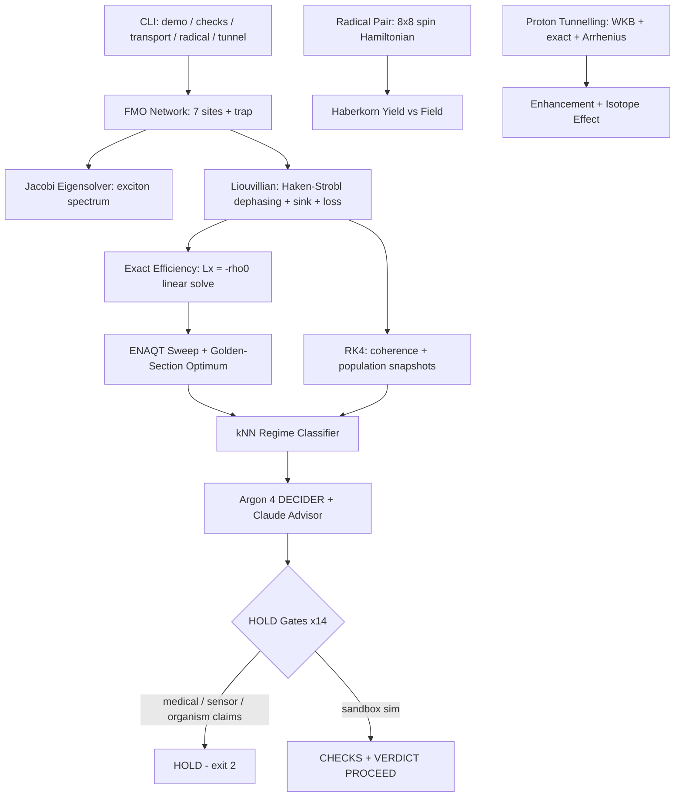
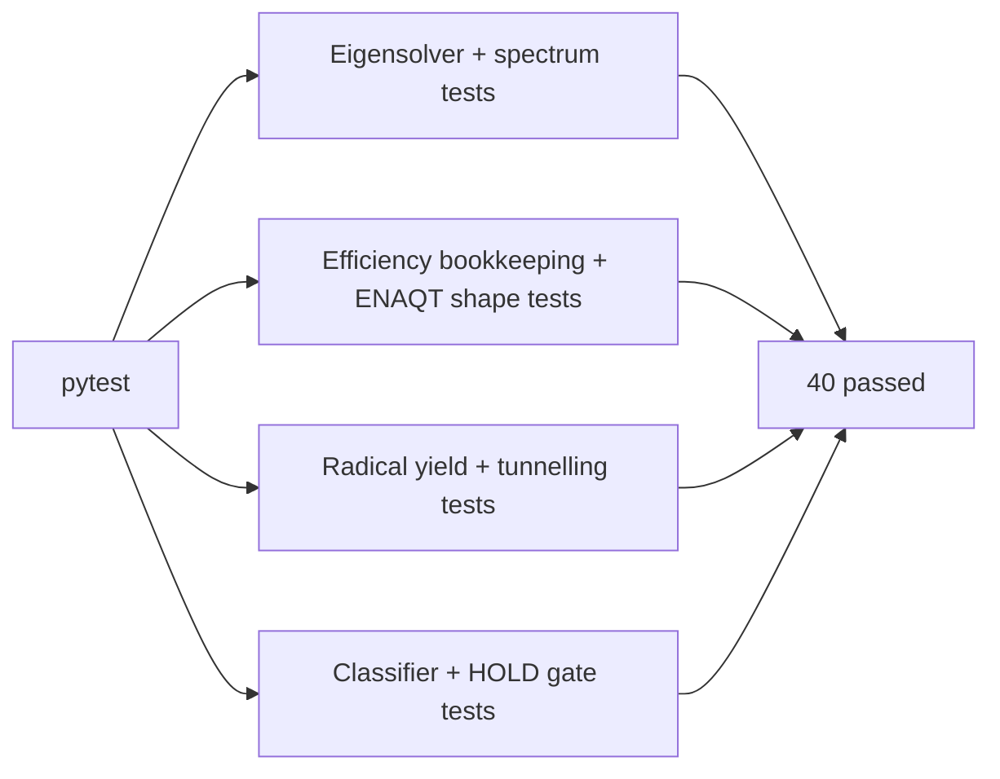
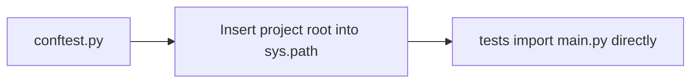
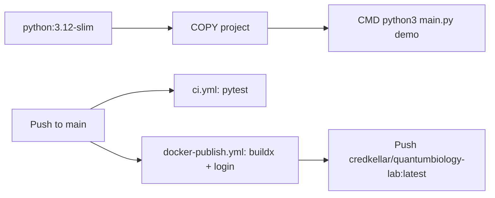

# QuantumBiology-Lab 🧬⚛️

**Quantum Biology Toy-Model Lab** — by Darion Kellar

QuantumBiology-Lab is an **educational quantum biology lab** in ONE pure-Python file. It computes, exactly and from scratch, the three toy models that anchor most quantum-biology discussions:

- 🌿 **Excitonic transport (ENAQT)** — a 7-site FMO-like network with labelled site energies and couplings, one trap site, Haken–Strobl dephasing, and an irreversible sink. The headline effect is measured, not asserted: transport efficiency **peaks at intermediate dephasing** — too little noise and the exciton localises coherently, too much and the quantum Zeno effect freezes it.
- 🧭 **Radical-pair toy** — a singlet-born electron pair with ONE hyperfine coupling and an applied field: the singlet yield is computed from the spin Hamiltonian's own spectrum and **moves with the field** (the avian-compass toy, labelled as a toy).
- ⚛️ **Proton tunnelling** — WKB transmission through a labelled rectangular barrier vs the classical Arrhenius over-barrier rate at the same attempt frequency, with the exact transmission formula and the deuterium isotope effect priced beside it.

Honest scope, stated up front: every parameter is a **labelled teaching value**. The site table is in the spirit of published FMO teaching tables; **nothing was measured from any organism, protein, bird, or enzyme**, and no output is a biological measurement. A toy efficiency peak is not photosynthesis, a toy yield curve is not a compass, and a WKB exponent is not an enzyme rate. Every medical / product / organism claim sits behind a permanent HOLD gate (14 total). 🔒

[](https://github.com/kimanicollier44-cmyk/QuantumBiology-Lab/actions/workflows/ci.yml)
[](https://github.com/kimanicollier44-cmyk/QuantumBiology-Lab/actions/workflows/docker-publish.yml)

> ℹ️ These are the **live** workflow badges for this repo. They activate as soon as the `ci.yml` and `docker-publish.yml` files from the paste pack are pasted into `.github/workflows/` — until then they have nothing to report yet.

## 🧰 Tech Stack Badges & Full Architecture Tech Stack

### 💻 Core Programming Languages & Core Systems


- 🐍 Python 3.12, pure standard library (`math`, `hashlib`, `json`, `sys`) — zero dependencies, zero network, deterministic (double-run byte-identical)
- 🌿 Transport core: a 49×49 complex Liouvillian (Haken–Strobl dephasing + trap + recombination) solved exactly — efficiency is `κ ∫ρ_trap dt` from one linear solve `Lx = −ρ(0)`, so `η + loss = 1` holds to <1e-9 and is asserted in CHECKS; RK4 density-matrix evolution for coherence and population snapshots
- 🧮 Eigensolver from scratch: cyclic Jacobi for real symmetric Hamiltonians, reconstruction `VΛVᵀ = H` asserted <1e-9 for both the 7×7 site Hamiltonian and the 8×8 radical-pair Hamiltonian
- 🧭 Radical pair: singlet yield from the exact spectrum with Haberkorn equal-rate weighting `k / (k + iΔE)` — no time integration, no sampling
- ⚛️ Tunnelling: WKB exponent from exact SI constants, checked against the exact rectangular-barrier transmission formula
- 🧠 TinyML kNN regime classifier (from scratch, stdlib): coherent-trapped / ENAQT-optimal / over-dephased from dephasing + efficiency + coherence, labels from the lab's own policy
- 🪑 Council seats: Gemini Argon 4 DECIDER (names-only, tighten-only) + Muse advisor (never overrides HOLD) + Google Flow plan-only (rendered = False, live = 0)

### ⛓️ Web3 & Infrastructure

- 🚫 **Not applicable — honestly.** No blockchain, no Web3, no tokens: the "infrastructure" in this lab is a labelled simulation of a pigment network, a spin pair, and a barrier inside one offline file. No fake badges here.

### ⚙️ Platform Support & Hardware Architecture


- 🖥️ Pure Python — runs anywhere Python 3.12+ runs (Linux, macOS, Windows), plus the `python:3.12-slim` Docker image
- 🔒 No organism, instrument, or hardware is touched, ever: real measurements and biological claims are permanent HOLD gates (see the gate table below)

### ⚡ Low-Level Infrastructure & Performance

- 🚫 **No low-level code — honestly.** No C, no C++, no GPU, no compiled extensions: this is one interpreted Python file on purpose, so every number can be read, checked, and diffed. Performance here means honest algorithms — an exact Liouvillian linear solve instead of long stochastic trajectories, a golden-section search for the ENAQT optimum, and stability-aware RK4 step sizing — all deterministic and byte-identical between runs.

### 🛠️ DevOps & Build Tools


- 🐳 Docker (`python:3.12-slim`), GitHub Actions CI + Docker Publish (delivered in the paste pack)
- 🎯 Target image: `credkellar/quantumbiology-lab:latest`
- 🧪 Tests: `pytest` (40 tests) + the built-in CHECKS suite (49 checks) in `main.py`

### ☁️ Cloud Providers

- 🚫 **None — honestly.** No cloud provider is used or needed: the lab runs fully offline on your own machine or in a local Docker container. Docker Hub appears only as the registry the publish workflow pushes the image to.

## What this does?

1. 🌿 **The FMO-like network** — 7 sites with labelled energies (12,210–12,630 cm⁻¹, Adolphs–Renger-style teaching values) and 21 couplings (strongest: site 1–2 at −87.7 cm⁻¹, site 5–6 at +81.1 cm⁻¹). Site 3 carries the lowest site energy and is the **trap**: an irreversible sink (κ = 1.0 /ps, labelled) collects the exciton there, while a uniform recombination loss (Γ = 0.01 /ps, labelled) competes for it. The exciton starts on site 1.
2. 🎼 **Exciton spectrum, from scratch** — a cyclic Jacobi eigensolver diagonalises the site Hamiltonian: exciton energies −30.01, 81.70, 155.09, 244.80, 259.67, 367.56, 471.20 cm⁻¹ (relative). The lowest exciton sits **77.9% on the trap site** and only 0.23% on the start site — the energy funnel is in the spectrum before any dynamics runs. Reconstruction `VΛVᵀ = H` is asserted <1e-9, not assumed.
3. 🎯 **Exact efficiency, no trajectories** — the time-integrated density matrix solves `Lx = −ρ(0)` for the 49×49 Liouvillian, so efficiency and loss are exact outputs of one linear solve: **η + loss = 1** to <1e-9 at every dephasing rate tested (γ = 0, 20, 320, 5120 rad/ps). The solve residual is asserted <1e-8 in CHECKS.
4. 📈 **The ENAQT sweep** — efficiency vs Haken–Strobl dephasing γ over 15 rates from 0 to 5120 rad/ps: η rises 0.5536 → 0.7259 → 0.8512 → 0.9094 and peaks, then falls 0.8927 → 0.7964 → 0.5466 → 0.3793. A golden-section search on log γ finds the optimum precisely: **η\* = 0.915700 at γ\* = 26.52 rad/ps (140.81 cm⁻¹)** — noise at roughly the coupling scale is what helps.
5. 🧊 **Both failure modes, priced** — at γ = 0 the exciton is **coherently trapped**: η = 0.553574, and 44.6% of excitations recombine before reaching the trap. At γ = 5120 rad/ps the **quantum Zeno effect** quenches hopping (∝ J²/γ): η = 0.379288, *worse than no noise at all*. The peak only makes sense with both ends measured.
6. 🌊 **Coherence, watched dying** — mean l1 coherence over the first picosecond (RK4, stability-aware step): **2.0376** at γ = 0 (it rings), **0.3967** at γ\* (enough coherence to move, enough noise to not localise), **0.0300** at γ = 1280 (quenched). Population snapshots at γ\* show the exciton spreading from site 1 across all 7 sites within 2 ps.
7. 🧭 **Radical pair — the spin Hamiltonian** — two electron spins + ONE nuclear spin ½, hyperfine `a·S₁·I` with `a = 1` (labelled units), Zeeman field `b` swept 0 → 3a. The 8×8 Hamiltonian is diagonalised by the same Jacobi solver; the singlet yield uses Haberkorn equal-rate weighting (k = 0.5a) over the exact spectrum — no Monte Carlo, no time stepping.
8. 🧲 **The yield curve** — Φ_S(0) = **0.700000**, dipping to **0.682573 at B/a = 0.75**, then rising through the zero-field value to **0.734909 at B/a = 3**: a total swing of **0.052336**. The field dependence is real in the toy — and the lab says in the same breath that a toy yield curve is not a bird compass and not a sensor (`in_vivo_navigation_claim`, `quantum_sensor_claim`: HOLD).
9. ⚛️ **Proton tunnelling, exact constants** — labelled rectangular barrier 0.60 eV × 0.50 Å, particle at E = k_BT (300 K): κ = 1.6634×10¹¹ /m, 2κL = 16.6343, **T_WKB = 5.9677×10⁻⁸**. The exact rectangular-barrier formula gives 3.9368×10⁻⁸ (ratio 0.6597) — the WKB exponent is honest to within its known prefactor error, and CHECKS assert the ratio stays in [0.3, 1.5].
10. 🚀 **Tunnelling vs classical, and the isotope bill** — at the same labelled attempt frequency (10¹³ Hz): tunnel rate **5.9677×10⁵ Hz** vs classical Arrhenius **8.3261×10² Hz** → enhancement **716.7×**. Swap the proton for a deuteron (m = 2m_p, labelled) and T falls to 6.0737×10⁻¹¹: a kinetic isotope effect of **982.6** — the √m in the WKB exponent, priced.
11. 🏷️ **Regime classifier + seats + checks** — a from-scratch kNN labels transport regimes from (γ, η, coherence): the γ = 0 point is coherent-trapped, the γ\* point is ENAQT-optimal, the γ = 1280 point is over-dephased — labels from the lab's own policy over its measured sweep ranges, with Argon 4 DECIDER (sha256 trace), Muse advisor, Google Flow plan-only, and a built-in CHECKS suite (49 checks).

## 🗺️ How it works — diagram per script

### `main.py` — the whole lab



### `tests/test_main.py` — verification



### `conftest.py` — test path setup



### `Dockerfile` + CI flow — container & publish



## Why is this cool?

1. 📈 The ENAQT peak is **found, not drawn**: a golden-section search over the exact efficiency surface lands on η\* = 0.915700 at γ\* = 26.52 rad/ps — the famous "noise helps transport" effect, recomputed from a Liouvillian you can read.
2. 🎯 Efficiency is **exact arithmetic**: no trajectories, no sampling error — one linear solve gives η and loss that sum to 1 to <1e-9, and the checks hold it there.
3. 🧊 Both ways to fail are in the same table: coherent localisation (η = 0.5536) and Zeno freezing (η = 0.3793) bracket the peak, so "a little noise helps" is a measurement with two controls.
4. 🎼 The funnel is visible **before dynamics**: the lowest exciton already sits 77.9% on the trap site and 0.23% on the start site — the spectrum explains the transport.
5. 🌊 Coherence is measured on a clock: 2.0376 ringing at γ = 0, 0.3967 at the optimum, 0.0300 quenched — the coherence–noise trade-off as three numbers.
6. 🧭 Φ_S(0) comes out at exactly **0.700000** from the spectrum — a clean analytic anchor the whole yield curve hangs from, dip and all.
7. 🧲 The yield **dip** is the interesting part: Φ_S falls to 0.682573 at B/a = 0.75 before rising past its zero-field value — non-monotone field response from an 8×8 matrix, no hand-waving.
8. ⚛️ WKB is **graded against the exact answer**: T_exact / T_WKB = 0.6597, inside the asserted [0.3, 1.5] band — the lab shows its approximation's error bar instead of hiding it.
9. 🚀 The isotope effect falls out of one square root: double the mass and the rate drops by **982.6×** — why H/D substitution is the classic tunnelling test, computed in four lines.
10. 🎯 Deterministic end to end: run it twice, get byte-identical output — quantum biology you can diff.

## What problems this solves?

1. ❌ **Problem:** "Quantum effects in biology" is usually asserted with adjectives, not numbers. ✅ **Solution:** Three toy models computed exactly, every parameter labelled, every headline number reproducible from `main.py` in seconds.
2. ❌ **Problem:** ENAQT is often described as "noise helps" with no failure mode on the other side. ✅ **Solution:** The full sweep is printed — coherent trapping at γ = 0, the peak at γ\*, and Zeno suppression below the no-noise value at high γ.
3. ❌ **Problem:** Transport efficiencies from stochastic simulations carry invisible sampling error. ✅ **Solution:** The efficiency here is a linear-algebra identity (η + loss = 1 to <1e-9), asserted in CHECKS at four dephasing rates.
4. ❌ **Problem:** Eigensolvers are usually library black boxes. ✅ **Solution:** The Jacobi solver is 40 lines in the open, and its reconstruction error is a checked quantity (<1e-9) for both Hamiltonians.
5. ❌ **Problem:** Radical-pair explainers jump from "birds sense fields" to a product. ✅ **Solution:** The toy yield curve is computed honestly (swing 0.052336) and the navigation/sensor claims are permanent HOLD gates in the same file.
6. ❌ **Problem:** Φ_S values get quoted without the recombination model that produced them. ✅ **Solution:** The Haberkorn equal-rate assumption (k = 0.5a) is a named constant in the code, and Φ_S + Φ_T = 1 is asserted.
7. ❌ **Problem:** WKB tunnelling factors are quoted as if exact. ✅ **Solution:** The exact rectangular-barrier transmission is computed beside WKB and the 0.6597 ratio is reported, not buried.
8. ❌ **Problem:** "Tunnelling enhancement" claims rarely name the classical comparison. ✅ **Solution:** Same barrier, same attempt frequency: 5.9677×10⁵ Hz vs 8.3261×10² Hz — the 716.7× is a ratio of two printed numbers.
9. ❌ **Problem:** Toy-model parameters quietly mutate into "measurements". ✅ **Solution:** Every constant is commented LABELLED, the docstring states nothing was measured from any organism, and `organism_measurement_claim` is a HOLD gate.
10. ❌ **Problem:** Simulation tools quietly imply a therapy, sensor, or crop product is next. ✅ **Solution:** 14 named HOLD gates return exit code 2 for every medical, drug, agriculture, sensor, navigation, or product claim, forever.

## How to install this?

1. 📋 Clone or download this project folder.
2. 🐍 Make sure Python 3.12+ is installed: `python3 --version`
3. ▶️ Run the full demo + checks (no arguments needed):

```bash
python3 main.py
```

4. 🧪 Run the test suite:

```bash
pip install pytest
python3 -m pytest -q
```

5. 🎛️ Try the other commands:

```bash
python3 main.py checks     # 49 built-in checks
python3 main.py transport  # FMO network, spectrum, ENAQT sweep + optimum (JSON)
python3 main.py radical    # radical-pair singlet yield vs field (JSON)
python3 main.py tunnel     # WKB + exact transmission, rates, isotope effect (JSON)
python3 main.py classify   # kNN transport-regime classifier report
python3 main.py brains     # Argon 4 + Muse + Flow seats
python3 main.py holds      # list all 14 HOLD gates
python3 main.py hold-demo  # exits 2 - gated actions stay HOLD
```

6. 🐳 Or run it in Docker:

```bash
docker build -t credkellar/quantumbiology-lab:latest .
docker run --rm credkellar/quantumbiology-lab:latest
```

## Requirements

- 🐍 Python 3.12 or newer
- 📦 Dependencies: **none** (standard library only)
- 🌐 Network: **none** — fully offline
- 🧪 For tests only: `pytest`
- 🐳 Optional: Docker

## FULL project structure tree

```text
quantumbiology-lab/
├── main.py                  # the whole lab: FMO transport + ENAQT, radical pair, proton tunnelling, classifier, seats, HOLD gates
├── conftest.py              # puts the project root on sys.path for tests
├── tests/
│   └── test_main.py         # 40 pytest tests: eigensolver, transport, ENAQT, radical pair, tunnelling, gates, determinism
├── assets/
│   └── cover.png            # README cover image (2736 x 912)
├── Dockerfile               # python:3.12-slim, runs the demo
├── .gitignore               # __pycache__/, .pytest_cache/, *.pyc
└── README.md                # this file
```

> 📦 Delivered separately as paste packs (not in this tree): `.github/workflows/ci.yml` + `docker-publish.yml`, and the Docker Hub pack (100-char description, 350-char About, overview, categories).

## 🔒 HOLD gates — all 14, permanent

| # | Gate | What stays held |
|---|------|-----------------|
| 1 | `medical_claim` | No medical, diagnostic, treatment, or health claims from a toy model |
| 2 | `drug_design_claim` | No drug design, binding, or efficacy claims |
| 3 | `agriculture_claim` | No crop-yield or photosynthesis-enhancement claims for real plants |
| 4 | `organism_measurement_claim` | No claiming any parameter here was measured from a real organism |
| 5 | `quantum_sensor_claim` | No magnetometer or quantum-sensor product claims; a yield curve is not a sensor |
| 6 | `consciousness_claim` | No consciousness, quantum-mind, or cognition claims |
| 7 | `clinical_trial_claim` | No clinical-trial design, dosing, or patient claims |
| 8 | `genetic_engineering_claim` | No genetic-engineering or gene-editing guidance |
| 9 | `longevity_claim` | No longevity, anti-ageing, or life-extension claims |
| 10 | `enzyme_product_claim` | No industrial enzyme or biocatalyst product claims from a WKB toy |
| 11 | `in_vivo_navigation_claim` | No claims about how real birds navigate; the radical pair here is a toy |
| 12 | `solar_energy_product_claim` | No artificial-photosynthesis or solar-product efficiency claims |
| 13 | `radiation_health_claim` | No radiation-exposure or health-risk claims |
| 14 | `supplement_claim` | No supplement, wellness, or nutrition claims |

🧑‍⚖️ **Council seats:** Gemini Argon 4 Extended Thinking — DECIDER (names-only, tighten-only, MAP → MODEL → STRESS → DECIDE, sha256 trace, `can_override_hold = False`) · Muse — advisor (`can_override_hold = False`) · Google Flow — plan-only (`rendered = False`, `live = 0`).

✅ **Verification:** pytest **40 passed** (project + clean copy) · built-in CHECKS **49/49** · double-run output **byte-identical** · `hold-demo` exits **2** · `main.py` **983 lines**, pure stdlib, zero network.

## 🧒 5th-grade English section

Imagine a tiny ball of energy landing on the first of **seven stepping stones** across a pond. The ball has to reach stone number 3, where a basket catches it. 🌿

- If everything is perfectly calm and quiet, the ball gets **stuck bouncing between the same stones** — being too perfect actually traps it! This lab measured that: it only reaches the basket about 55 times out of 100.
- Now shake the pond **a little**. The shaking bumps the ball out of its trap, and it finds the basket about 92 times out of 100. Scientists call this **ENAQT** — a little bit of noise helps the energy travel.
- But shake the pond **way too hard** and the ball can barely move at all — it reaches the basket only 38 times out of 100. Too much shaking freezes it. The best amount is right in the middle, and the lab finds that exact amount with math. 🎯
- The lab also plays with two magnets-and-spins toys that react to a magnetic field (a pretend version of how some scientists think birds might sense direction — but this is just a toy, not a real bird 🧭), and a proton that can **sneak through a wall it could never climb over** — that's called tunnelling, and it works about 717 times better than climbing at room temperature. ⚛️
- This project is a **pretend lab on a computer**. It does not measure any real plant, bird, or body. It helps you learn how tiny quantum tricks *could* matter in living things — with the math shown, not just promised. 💻

---

MIT © 2026 Darion Kellar · QuantumBiology-Lab — educational simulation only 🧬
